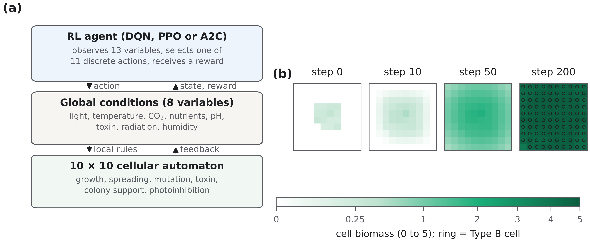

# MicroAlfi World

**Reinforcement learning control of a simulated microalgae bioreactor.**

Code, trained models and verified results for the paper:

> Umar, M., Maul, T. *Reinforcement Learning for Control of a Simulated Microalgae Bioreactor: Algorithm, Reward and Robustness Comparisons.* Manuscript submitted to *Computers & Chemical Engineering*.

A 10 × 10 cellular automaton represents a microalgal colony whose growth, spreading, mutation and toxin production emerge from local rules. A single agent outside the grid controls eight global conditions (light, CO₂, nutrients, pH, toxin filtering, radiation shielding, humidity and growth pulses) through eleven discrete actions, while six passive drifts change the conditions over time.

<p align="center"></p>

## Key results

All values are means over 3 training seeds × 20 held-out evaluation episodes (hard world with drifts, deterministic evaluation).

| Controller | Evaluation reward | Final biomass (max 500) | Coverage |
|---|---|---|---|
| DQN | **5220.9** | **497.2** | 100.0% |
| PPO | 2836.0 | 275.0 | 94.3% |
| A2C | 1180.2 | 95.6 | 90.9% |
| Fixed setpoint (rule-based) | 4172.3 | 396.7 | 88.6% |
| Random | 177.1 | 9.2 | 39.6% |

- **Proxy rewards fail.** A coverage-based reward, analogous to optical density, kept 87% of the grid occupied but yielded 43 biomass units.
- **Learning pays most under drift.** DQN's lead over the rule-based controller was 118 to 376 reward units without drift and 841 to 1215 with drift.
- **Training under drift produces better policies.** A cross-evaluation shows that drift-trained policies outperform static-trained ones in both environments.

## Quick start

```bash
git clone https://github.com/Umar21233/A-MicroAlfi-World.git
cd A-MicroAlfi-World
python -m venv venv
source venv/bin/activate        # Windows: venv\Scripts\activate
pip install -r requirements-dev.txt
pytest -q                       # 57 tests
```

Python 3.12. Exact package versions are pinned in `requirements.txt`.

**Run the rule-based controller**

```bash
python -m agents.fixed_setpoint_agent_v2 --world hard --episodes 5 --render
```

**Evaluate a trained model**

```bash
python -m training.evaluate --algo dqn --world hard --seed 42 --new_naming \
    --model_path results_verified/phase1/dqn_hard_multi_objective_drifts_42/model.zip
```

**Train from scratch** (about 18 minutes per run on one CPU core)

```bash
python -m training.train_dqn --world hard --reward_mode multi_objective --seed 42 --tuned
```

**Regenerate the figures**

```bash
python generate_plots.py
```

## Repository structure

```
envs/                 Simulator (AlphaeWorldEnvV2) and pygame renderer
agents/               Random and fixed setpoint baseline controllers
training/             DQN, PPO and A2C training scripts, evaluation, hyperparameters
experiments/
  drift_study/        Cross-evaluation and drift ablation (Section 5.4 of the paper)
results_verified/     All 39 trained models and their evaluation data
  phase1/             Algorithm comparison (DQN, PPO, A2C)
  phase2/             Reward formulation comparison
  phase3/             Model complexity × drift
  baselines/          Random and fixed setpoint results
  drift_study/        Cross-evaluation results
  diagnostics/        Deterministic versus stochastic evaluation
figures/paper/ and figures/generated/  Figures used in the paper, and figures regenerated from results_verified/
scripts/              Data consolidation and verification utilities
tests/                Environment property and regression tests
data_manifest.json    SHA-256 hashes of every raw training output
```

Each run folder in `results_verified/` is named `{algo}_{world}_{reward_mode}_{drift}_{seed}` and contains the trained `model.zip`, its config, the training curve, the evaluation episodes and the coverage trajectory.

## Reproducibility

- Training seeds 42, 43 and 44; evaluation seeds 100 to 119, never used in training.
- Hyperparameters are listed in `training/hyperparameters.py` and in Table 5 of the paper.
- Every raw training output is hashed in `data_manifest.json`. Re-evaluating the saved models reproduces the published results (see `docs/REPRODUCIBILITY.md`).

## Citation

If you use this code, please cite the paper (citation details will be added on publication) or the archived release:

```bibtex
@software{umar_microalfi_world,
  author = {Umar, Muhammad and Maul, Tomas},
  title  = {MicroAlfi World: reinforcement learning control of a simulated microalgae bioreactor},
  year   = {2026},
  doi    = {ZENODO-DOI},
  url    = {https://github.com/Umar21233/A-MicroAlfi-World}
}
```

## License

Released under the MIT License. See `LICENSE`.
